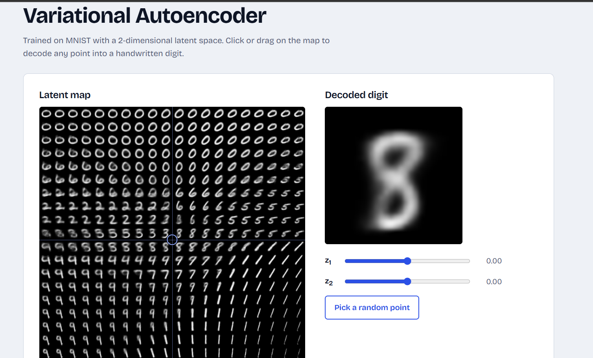
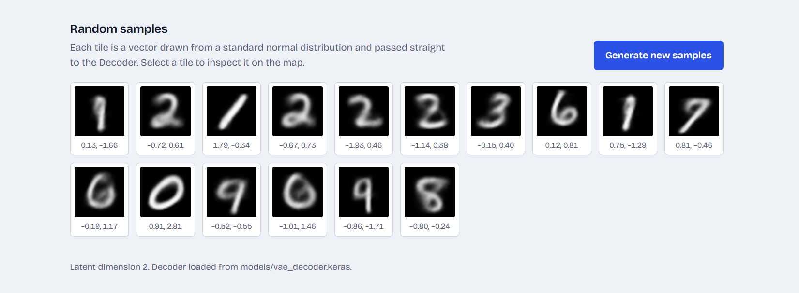

# VAE on MNIST: Digit Generator

A Variational Autoencoder (VAE) trained on MNIST with TensorFlow/Keras, plus a Flask web app that lets you explore the learned 2-dimensional latent space and generate new handwritten digits from the trained Decoder.

Built for GenAI Lab Experiment 5 (Department of Computer Science & Engineering, AIML).

## Screenshots

**Latent map and decoded digit.** Click or drag on the map, or use the z1 and z2 sliders, to decode any point of the latent space.



**Random samples.** Digits generated by passing vectors drawn from N(0, I) straight to the Decoder.



## Features

- Interactive latent map: a grid of digits decoded across the 2-D latent space (z1 and z2 from -3 to 3), with click, drag, slider and keyboard control
- Live decoding of the selected point into a 28x28 digit
- Random digit generation from the standard normal prior N(0, I)
- Clicking a random sample moves the map to that sample's latent vector
- The Decoder is the only model the app needs

## How it works

- **Encoder:** Flatten, then Dense layers, producing `z_mean` (mu) and `z_log_var` (log sigma squared) for a 2-D latent space.
- **Reparameterization trick:** `z = mu + sigma * epsilon`, where `sigma = exp(0.5 * log sigma squared)` and `epsilon ~ N(0, I)`. This keeps sampling differentiable.
- **Decoder:** Dense layers, then a sigmoid output reshaped to a 28x28x1 image.
- **Loss:** Reconstruction loss (binary cross-entropy summed over pixels) plus KL divergence from N(0, I), minimized with a custom `train_step()`.
- **Generation:** sample `z ~ N(0, I)` and pass it to the trained Decoder.

Training configuration: original dimension 784, latent dimension 2, batch size 128, 30 epochs, Adam optimizer.

## Project structure

```
vae-mnist-generator/
├── app.py                  Flask backend (loads the Decoder, serves the API)
├── requirements.txt
├── models/
│   └── vae_decoder.keras   Trained Decoder (from the notebook)
├── notebook/
│   └── Exp5_VAE_MNIST.ipynb   Colab notebook: training, plots, model export
├── static/
│   ├── style.css
│   └── script.js
├── templates/
│   └── index.html
└── screenshots/
```

## Getting started

### 1. Train the model in Google Colab

1. Open `notebook/Exp5_VAE_MNIST.ipynb` in Google Colab.
2. Select a GPU runtime (Runtime > Change runtime type).
3. Run all cells. The notebook trains the VAE, plots the losses, reconstructions and latent space, and saves `vae_encoder.keras` and `vae_decoder.keras`.
4. Download `vae_models.zip` from the last cell and extract it.
5. Copy `vae_decoder.keras` into the `models/` folder of this project.

### 2. Run the web app locally

Requires Python 3.9 to 3.12.

```bash
python -m venv venv

# Windows (PowerShell)
venv\Scripts\Activate.ps1
# macOS / Linux
source venv/bin/activate

pip install -r requirements.txt
python app.py
```

Open http://127.0.0.1:5000 in your browser.

If the model fails to load, install the same TensorFlow version that was used in Colab (printed by the last notebook cell): `pip install tensorflow==<version>`.

## API

| Method | Endpoint | Description |
| --- | --- | --- |
| GET | `/` | Web interface |
| GET | `/api/info` | Latent dimension and map range |
| POST | `/api/generate` | Body `{"z": [z1, z2]}`; returns the decoded digit as a PNG data URI |
| GET | `/api/random?n=16` | Returns `n` digits (1 to 36) decoded from random N(0, I) vectors |
| GET | `/api/map` | Returns the latent map image (2-D latent space only) |

## Tech stack

Python, TensorFlow/Keras, NumPy, Matplotlib, Flask, Pillow, HTML, CSS, JavaScript

## Author

Srushti ([@srushtighatge25-commits](https://github.com/srushtighatge25-commits))
